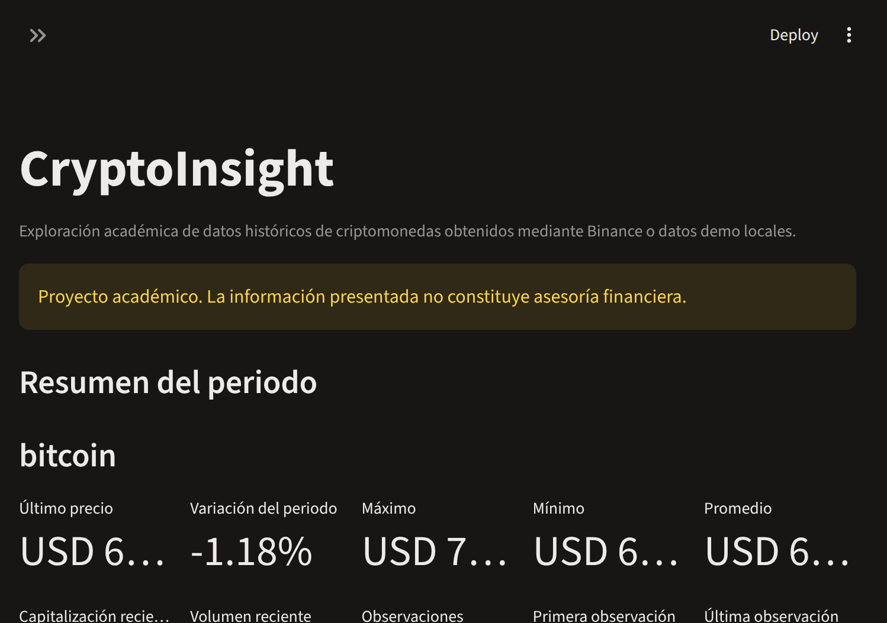
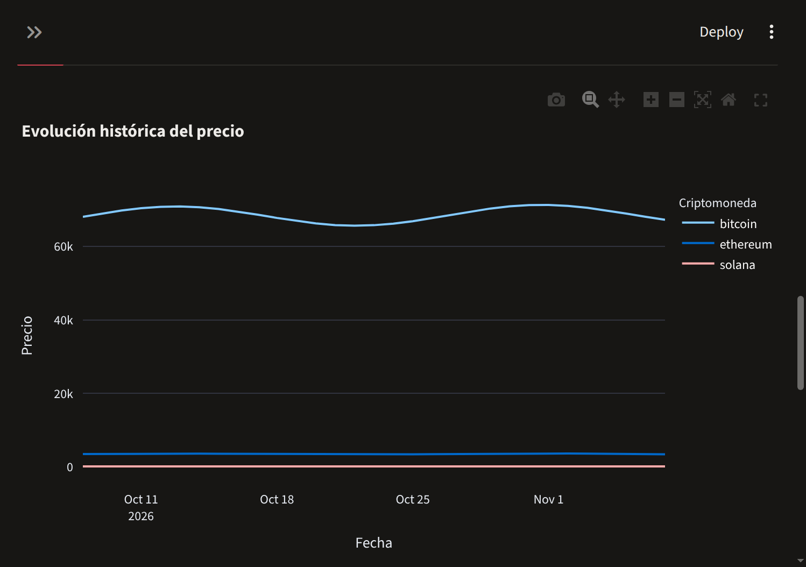
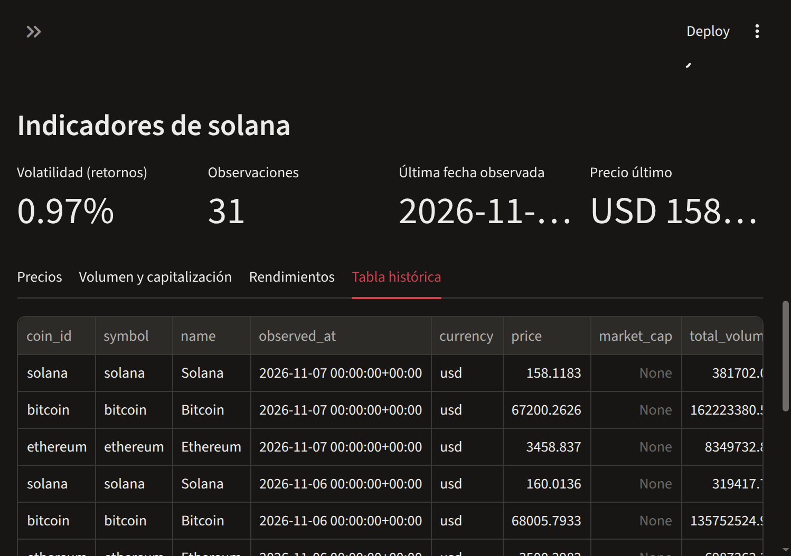

# CryptoInsight

> MVP de ingeniería de datos para transformar velas públicas de criptomonedas
> en información histórica consultable y visualizable.

[](https://www.python.org/)
[](https://fastapi.tiangolo.com/)
[](https://streamlit.io/)
[](https://www.binance.com/en/markets)

## 1. Propósito del proyecto

CryptoInsight resuelve un problema concreto: convertir datos de mercado
disponibles públicamente en una pequeña solución analítica reproducible.

El sistema:

1. Obtiene velas diarias desde la API pública de Binance.
2. Valida y normaliza los datos recibidos.
3. Persiste las observaciones en SQLite.
4. Evita duplicados cuando se repite una ingestión.
5. Expone los datos mediante una API REST.
6. Calcula indicadores y los presenta en un dashboard.

El resultado es un flujo completo de datos, desde la fuente externa hasta una
interfaz de análisis. El objetivo no es hacer trading: es demostrar un proceso
de ingeniería de datos pequeño, trazable y funcional.

> **Aviso:** los datos y las métricas son educativos. CryptoInsight no compra,
> vende, predice precios ni ofrece asesoría financiera.

## 2. Producto funcionando

### Resumen e indicadores

Esta captura muestra el valor principal del producto: métricas calculadas sobre
el periodo seleccionado para cada activo.



### Gráficas de análisis

La sección de gráficas permite observar precio, promedio móvil, volumen y
rendimientos sin revisar los registros uno por uno.



### Tabla histórica

La tabla permite inspeccionar los registros procesados y descargar el resultado
en CSV para continuar el análisis.



### GIF del flujo completo


El GIF recorre las tres vistas útiles del producto: resumen, gráficas y tabla.
Para reproducir la demostración:

```bash
./run-mvp.sh
```

Después abre <http://127.0.0.1:8501>.

## 3. Alcance del MVP

### Incluido

- Consulta de velas diarias de Binance Spot.
- Consumo sin API key, cuenta externa ni login.
- Activos iniciales: Bitcoin, Ethereum y Solana.
- Incorporación de otros símbolos compatibles con Binance.
- Monedas de cotización: `usd`, `usdt` y `eur`.
- Persistencia local en `cryptoinsight.db`.
- Ingestión idempotente por activo, fecha y moneda.
- Precio inicial, final, máximo, mínimo, promedio y variación.
- Volumen, rendimientos, promedio móvil y rendimiento acumulado.
- Historial de ejecuciones de ingestión.
- API documentada con OpenAPI/Swagger.
- Datos demo locales claramente identificados si la red no permite consultar
  Binance, para que el producto siga siendo demostrable.

### Fuera del alcance

- Órdenes, compra, venta o trading automatizado.
- Conexión a cuentas, saldos o claves privadas de Binance.
- Portafolios, alertas, predicciones o señales de inversión.
- Usuarios, roles, pagos, JWT o autenticación.
- MySQL, PostgreSQL, NestJS y el módulo de productos de la versión anterior.
- Ejecución de FastAPI o Streamlit dentro de GitHub Pages.

## 4. Proceso de ingeniería de datos

### 4.1 Fuente y extracción

FastAPI solicita velas diarias al endpoint público de Binance:

```text
GET https://api.binance.com/api/v3/klines
```

La consulta se construye con:

- `symbol`: por ejemplo, `BTCUSDT`.
- `interval=1d`.
- `startTime` y `endTime` en milisegundos UTC.
- `limit` para controlar el tamaño de la respuesta.

Los identificadores amigables se traducen a mercados:

| Entrada | Mercado |
|---|---|
| `bitcoin` o `btc` | `BTCUSDT` |
| `ethereum` o `eth` | `ETHUSDT` |
| `solana` o `sol` | `SOLUSDT` |
| `dogecoin` o `doge` | `DOGEUSDT` |

### 4.2 Validación y normalización

Antes de persistir, la API:

- Normaliza identificadores y monedas a minúsculas.
- Valida el formato de los activos.
- Rechaza rangos donde la fecha final sea anterior a la inicial.
- Convierte timestamps de Binance a `datetime` UTC.
- Convierte precios y volúmenes a valores numéricos controlados.
- Rechaza respuestas externas con estructura inválida.
- Registra errores de proveedor sin ocultarlos al usuario.

Si Binance no responde por restricciones de red del entorno, se genera una
serie demo determinista. Esa serie se marca explícitamente como `Demo local`
en la columna `source`; nunca se presenta como cotización real.

### 4.3 Modelo de almacenamiento

SQLite mantiene tres entidades:

| Tabla | Propósito |
|---|---|
| `cryptocurrencies` | Catálogo de activos consultados |
| `market_prices` | Precio, volumen, fecha, moneda y fuente |
| `ingestion_runs` | Estado, rango, contadores y errores de cada ejecución |

La tabla `market_prices` tiene una restricción única sobre:

```text
cryptocurrency_id + observed_at + currency
```

Por eso repetir una ingestión actualiza la observación existente en vez de
crear duplicados. La persistencia se realiza mediante un upsert SQLite.

### 4.4 Transformación y consumo

El servicio de mercado transforma las filas almacenadas en dos salidas:

- **Datos históricos:** registros ordenados por fecha y activo.
- **Resumen:** precio inicial y final, máximo, mínimo, promedio, variación,
  volumen reciente y número de observaciones.

Streamlit consume esas salidas por HTTP y calcula visualizaciones adicionales:

- Precio histórico.
- Promedio móvil.
- Volumen y capitalización disponible.
- Rendimientos diarios.
- Rendimiento acumulado.
- Serie normalizada.
- Histograma de rendimientos.

### 4.5 Trazabilidad y resiliencia

Cada ingestión se registra en `ingestion_runs` con:

- Activo y moneda.
- Fecha inicial y final.
- Registros recibidos.
- Registros guardados o actualizados.
- Estado: `running`, `success` o `failed`.
- Mensaje de error y timestamps.

Si una fuente externa falla, los datos previamente guardados no se eliminan.
Esto permite mantener la continuidad del análisis y distinguir entre datos
reales de Binance y datos demo.

## 5. Arquitectura

```text
┌────────────────────┐       HTTP        ┌────────────────────┐
│ Streamlit :8501    │ ────────────────> │ FastAPI :8000      │
│ filtros y gráficas │                   │ API y pipeline    │
└────────────────────┘                   └─────────┬──────────┘
                                                   │
                              ┌────────────────────┴───────────────┐
                              │                                    │
                    Binance Spot API pública              SQLite local
                    extracción de velas                 cryptoinsight.db
```

| Componente | Responsabilidad |
|---|---|
| `crypto-dashboard` | Interfaz, filtros, métricas y visualizaciones |
| `crypto-api` | Validación, extracción, transformación, persistencia y API |
| Binance | Fuente externa de datos |
| SQLite | Almacenamiento local e idempotencia |

## 6. Ejecución local

### Requisitos

- Python 3.10 o superior.
- `curl`.
- Acceso de red a Binance para datos reales.
- Docker es opcional.

### Inicio rápido

Desde la raíz del proyecto:

```bash
chmod +x run-mvp.sh
./run-mvp.sh
```

El script crea `.venv`, instala dependencias, inicia FastAPI y arranca
Streamlit. URLs disponibles:

| Servicio | URL |
|---|---|
| Dashboard | <http://127.0.0.1:8501> |
| Swagger | <http://127.0.0.1:8000/docs> |
| Healthcheck | <http://127.0.0.1:8000/health> |

Presiona `Ctrl+C` para detener los servicios.

### Docker Compose

```bash
docker compose up --build
```

Compose publica los mismos puertos y utiliza el volumen `crypto_data` para
conservar SQLite entre reinicios.

## 7. Uso del dashboard

1. Selecciona uno o varios activos.
2. Selecciona `usd`, `usdt` o `eur`.
3. Define las fechas inicial y final.
4. Presiona **Actualizar desde Binance**.
5. Revisa el resumen, los indicadores, las gráficas y la tabla histórica.

Si el símbolo no existe en Binance, la API devuelve un error y no inventa
observaciones. Si el proveedor está bloqueado por la red, el sistema utiliza
datos demo locales identificados en el historial.

## 8. API REST

La especificación interactiva está disponible en
<http://127.0.0.1:8000/docs>.

| Método | Endpoint | Descripción |
|---|---|---|
| `GET` | `/health` | Comprueba API, tablas y SQLite |
| `GET` | `/api/coins` | Lista activos almacenados |
| `GET` | `/api/market-data` | Consulta observaciones históricas |
| `GET` | `/api/market-summary` | Devuelve indicadores agregados |
| `POST` | `/api/ingest` | Ejecuta extracción y persistencia |
| `GET` | `/api/ingestion-runs` | Lista ejecuciones recientes |

Ejemplo:

```bash
curl -X POST http://127.0.0.1:8000/api/ingest \
  -H "Content-Type: application/json" \
  -d '{
    "coin_ids": ["btc"],
    "currency": "usd",
    "start_date": "2026-10-01",
    "end_date": "2026-10-07"
  }'
```

No se requieren encabezados de autenticación en este MVP.

## 9. Publicación

### GitHub Pages

La página estática se encuentra en [`docs/index.html`](./docs/index.html) y se
publica con [`.github/workflows/pages.yml`](./.github/workflows/pages.yml).

URL del proyecto:

<https://Erikafantomex.github.io/intro-cienciadatos/>

GitHub Pages sirve la portada, pero no ejecuta Python. Para publicar el
dashboard interactivo hay que desplegar los dos servicios en una plataforma
con soporte para Python y configurar `CRYPTO_API_URL`.

### Opciones para el dashboard

- Streamlit Community Cloud.
- Render.
- Railway.
- Un servidor propio con Docker Compose.

## 10. Estructura del proyecto

```text
crypto-api/
└── app/
    ├── main.py                 API FastAPI y ciclo de inicio
    ├── coingecko_client.py     Adaptador HTTP para Binance y fallback demo
    ├── config.py               Configuración por entorno
    ├── database.py             Motor y sesiones SQLite
    ├── ingestion_service.py    Modelos, upsert e historial de ingestión
    ├── market_service.py       Consultas y resúmenes
    └── schemas.py              Validación de solicitudes y respuestas
crypto-dashboard/
    ├── app.py                  Interfaz Streamlit
    ├── api_client.py           Cliente HTTP de FastAPI
    ├── charts.py               Gráficas Plotly
    └── indicators.py           Indicadores de análisis
docs/
    ├── dashboard-resumen.png  Métricas e indicadores
    ├── dashboard-graficas.png Gráficas de análisis
    ├── dashboard-tabla.png    Tabla histórica
    ├── dashboard-demo.gif     Recorrido visual del producto
    └── index.html              Portada de GitHub Pages
compose.yaml                    Despliegue con Docker Compose
run-mvp.sh                      Arranque local
```

## 11. Verificación

El MVP se validó con:

- Compilación de los módulos Python.
- Arranque de FastAPI con SQLite vacío.
- Creación automática de tablas.
- Carga inicial de 31 observaciones demo por activo.
- Respuesta correcta de `/health`.
- Respuesta de `/api/market-data` y `/api/market-summary`.
- Renderizado de métricas y gráficas en Streamlit.
- Verificación de ingestión idempotente.
- Captura del dashboard funcionando.

## 12. Limitaciones

Binance puede limitar solicitudes, bloquear regiones o no disponer de todos los
pares. La granularidad está fijada en velas diarias. La disponibilidad y
exactitud de los datos reales dependen del proveedor externo.

Los datos demo existen únicamente para garantizar una demostración funcional
cuando no hay conectividad. Están marcados como `Demo local` y no deben usarse
para tomar decisiones financieras.

## Licencia

Consulta [`LICENSE`](./LICENSE) para conocer los términos de uso.
