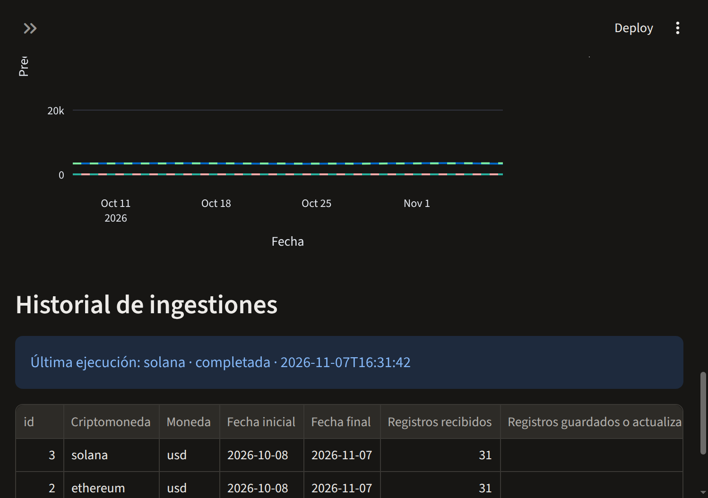
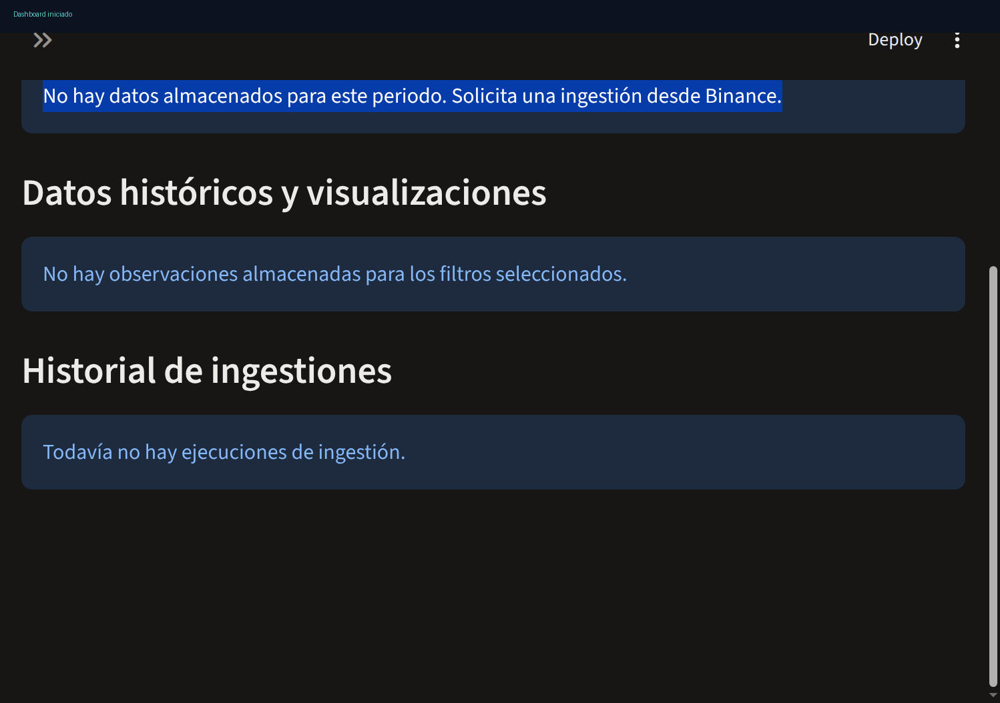

# CryptoInsight

> MVP académico para explorar datos históricos de criptomonedas.

[](https://www.python.org/)
[](https://fastapi.tiangolo.com/)
[](https://streamlit.io/)
[](https://www.binance.com/en/markets)

CryptoInsight permite consultar, almacenar y visualizar precios históricos de
criptomonedas. La aplicación obtiene velas diarias desde la API pública de
Binance, las persiste en SQLite y presenta métricas y visualizaciones mediante
Streamlit.

**Aviso:** este proyecto es educativo. No ejecuta operaciones, no administra
fondos y no constituye asesoría financiera.

## Demo y documentación

- **Página del proyecto:** <https://Erikafantomex.github.io/intro-cienciadatos/>
- **Repositorio:** <https://github.com/Erikafantomex/intro-cienciadatos>
- **Swagger local:** <http://127.0.0.1:8000/docs>

GitHub Pages publica la portada y documentación estática. El dashboard
interactivo requiere ejecutar Python en local o desplegarlo en una plataforma
que soporte aplicaciones Python, como Streamlit Community Cloud, Render o
Railway.

## Vista del producto

### Dashboard en funcionamiento



La captura anterior fue tomada con la aplicación ejecutándose localmente. La
vista muestra la interfaz de selección de activos, rango de fechas, conexión
con la API y las secciones de resumen, datos históricos y visualizaciones.

### Recorrido visual



Para una demostración reproducible, ejecuta `./run-mvp.sh` y abre
<http://127.0.0.1:8501>. El repositorio incluye esta vista animada como
previsualización ligera; GitHub renderiza GIF directamente en el README sin
requerir un servicio externo de video.

## Funcionalidades

- Consulta de velas diarias desde Binance Spot.
- Sin API key, cuenta de Binance ni autenticación de usuario.
- Selección de criptomonedas y rango de fechas.
- Soporte para `usd`, `usdt` y `eur`.
- Persistencia local en SQLite.
- Ingestión idempotente: repetir una consulta no duplica observaciones.
- Indicadores de precio inicial, final, máximo, mínimo, promedio y variación.
- Gráficas de precio, volumen, rendimientos y promedio móvil.
- API REST documentada automáticamente con OpenAPI/Swagger.
- Healthcheck para verificar la disponibilidad del servicio.

## Alcance y límites

### Incluido en este MVP

El proyecto cubre un flujo completo y demostrable de análisis histórico:

1. El usuario selecciona un activo y un periodo.
2. FastAPI solicita las velas a Binance.
3. Las observaciones se validan y almacenan en SQLite.
4. Streamlit consulta los datos guardados.
5. El dashboard calcula indicadores y genera visualizaciones.

### No incluido

- Compra, venta, órdenes o trading automatizado.
- Conexión a cuentas, saldos o claves privadas de Binance.
- Portafolios, alertas, predicciones o señales de inversión.
- Usuarios, roles, login, JWT o pagos.
- MySQL, PostgreSQL, NestJS o el módulo de productos de la versión anterior.
- Dashboard ejecutable directamente en GitHub Pages.

## Arquitectura

```text
┌──────────────┐       HTTP        ┌──────────────┐
│  Streamlit   │ ────────────────> │   FastAPI    │
│    :8501     │                   │    :8000     │
└──────────────┘                   └──────┬───────┘
                                          │
                             ┌────────────┴────────────┐
                             │                         │
                       Binance API              SQLite local
                    (fuente pública)          (cryptoinsight.db)
```

| Componente | Responsabilidad |
|---|---|
| `crypto-dashboard` | Interfaz, filtros, métricas y gráficas |
| `crypto-api` | Validación, ingestión, persistencia y consultas |
| Binance Spot API | Fuente externa de velas públicas |
| SQLite | Almacenamiento local sin configuración adicional |

## Requisitos

Para ejecutar localmente:

- Python 3.10 o superior.
- `curl`.
- Acceso de red a `api.binance.com`.

Docker y una cuenta externa no son necesarios.

## Inicio rápido

Desde la raíz del proyecto:

```bash
chmod +x run-mvp.sh
./run-mvp.sh
```

El script:

1. Crea el entorno virtual `.venv`.
2. Instala las dependencias de FastAPI y Streamlit.
3. Inicia la API en el puerto `8000`.
4. Inicia el dashboard en el puerto `8501`.

Abre el dashboard en <http://127.0.0.1:8501>.

La base de datos se crea automáticamente como `cryptoinsight.db`. Para detener
ambos servicios, presiona `Ctrl+C`.

## Ejecución con Docker

Con Docker Compose instalado:

```bash
docker compose up --build
```

Servicios publicados:

| Servicio | URL |
|---|---|
| Dashboard | <http://127.0.0.1:8501> |
| API y Swagger | <http://127.0.0.1:8000/docs> |
| Healthcheck | <http://127.0.0.1:8000/health> |

El volumen `crypto_data` conserva la base SQLite entre reinicios.

## Uso del dashboard

1. Selecciona una o más criptomonedas.
2. Selecciona una moneda de cotización: `usd`, `usdt` o `eur`.
3. Define la fecha inicial y la fecha final.
4. Presiona **Actualizar desde Binance**.
5. Consulta los indicadores y las gráficas.

Los identificadores comunes se traducen a mercados de Binance:

| Identificador | Mercado consultado |
|---|---|
| `bitcoin` o `btc` | `BTCUSDT` |
| `ethereum` o `eth` | `ETHUSDT` |
| `solana` o `sol` | `SOLUSDT` |
| `dogecoin` o `doge` | `DOGEUSDT` |

También se pueden agregar otros identificadores si existe el mercado
correspondiente en Binance. Un símbolo inválido produce un error y no genera
datos ficticios.

## API

La especificación interactiva está disponible en
<http://127.0.0.1:8000/docs> después de iniciar el proyecto.

| Método | Endpoint | Descripción |
|---|---|---|
| `GET` | `/health` | Comprueba API, tablas y SQLite |
| `GET` | `/api/coins` | Lista activos almacenados |
| `GET` | `/api/market-data` | Consulta observaciones históricas |
| `GET` | `/api/market-summary` | Devuelve indicadores agregados |
| `POST` | `/api/ingest` | Descarga y guarda velas de Binance |
| `GET` | `/api/ingestion-runs` | Lista ejecuciones recientes |

### Ejemplo de ingestión

```bash
curl -X POST http://127.0.0.1:8000/api/ingest \
  -H "Content-Type: application/json" \
  -d '{
    "coin_ids": ["btc"],
    "currency": "usd",
    "start_date": "2026-10-01",
    "end_date": "2026-10-07"
  }'
```

No se requieren encabezados de autenticación en este MVP.

## Publicación en GitHub Pages

La página estática se encuentra en [`docs/index.html`](./docs/index.html) y se
publica mediante [`.github/workflows/pages.yml`](./.github/workflows/pages.yml).

Para activarla:

1. Sube el repositorio a GitHub.
2. Abre **Settings → Pages**.
3. Selecciona **GitHub Actions** como fuente de despliegue.
4. Ejecuta un push a la rama `main`.

GitHub Pages no ejecuta FastAPI, SQLite ni Streamlit. Para publicar el
dashboard, despliega `crypto-api` y `crypto-dashboard` en un proveedor con
soporte para Python y configura `CRYPTO_API_URL` con la URL pública de FastAPI.

## Estructura del proyecto

```text
crypto-api/
└── app/
    ├── main.py                 API FastAPI y rutas
    ├── coingecko_client.py     Adaptador HTTP para Binance
    ├── config.py               Configuración por entorno
    ├── database.py             Motor y sesiones SQLite
    ├── ingestion_service.py    Modelos e ingestión idempotente
    ├── market_service.py       Consultas y resúmenes
    └── schemas.py              Validación de solicitudes y respuestas
crypto-dashboard/
├── app.py                      Interfaz Streamlit
├── api_client.py               Cliente HTTP de FastAPI
├── charts.py                   Gráficas
└── indicators.py               Indicadores
docs/index.html                 Portada de GitHub Pages
compose.yaml                    Despliegue con Docker Compose
run-mvp.sh                      Arranque local
```

## Calidad y verificación

Validaciones realizadas durante el desarrollo:

- Compilación de los módulos Python.
- Arranque de FastAPI con SQLite.
- Respuesta correcta de `/health`.
- Arranque de Streamlit.
- Verificación del adaptador de Binance sin autenticación.
- Verificación de la publicación estática en `docs/`.

## Limitaciones conocidas

Binance puede limitar solicitudes, bloquear regiones o no disponer de todos los
pares. La API registra las ejecuciones y conserva los datos anteriores si una
descarga falla. La disponibilidad, granularidad y exactitud de los resultados
dependen del proveedor externo.

## Licencia

Consulta el archivo [`LICENSE`](./LICENSE) para conocer los términos de uso del
proyecto.
