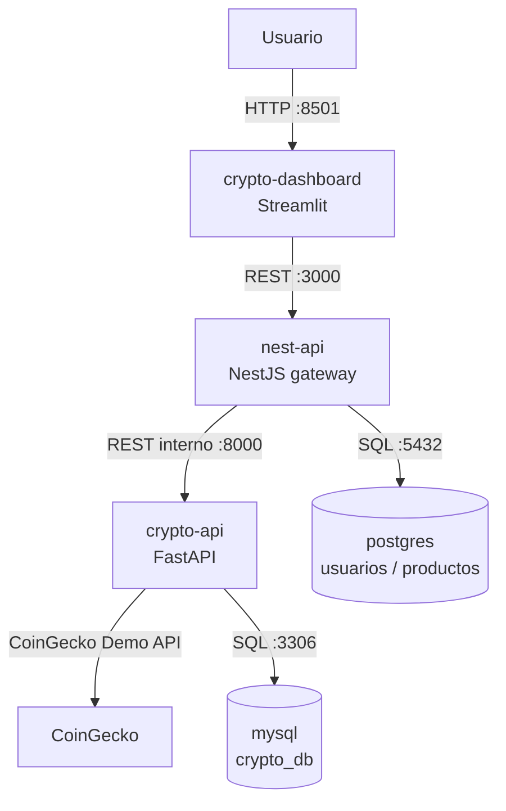

# CryptoInsight

CryptoInsight es un proyecto académico para consultar, almacenar y visualizar
series históricas de criptomonedas. CoinGecko Demo API proporciona los datos;
la ingestión se solicita autenticada y los resultados se guardan en MySQL.
Streamlit presenta indicadores y gráficos, y se comunica exclusivamente con
NestJS. NestJS actúa como gateway REST hacia FastAPI y conserva PostgreSQL
para sus usuarios, autenticación y productos existentes.

> Proyecto académico. La información presentada no constituye asesoría financiera.

## Arquitectura

La aplicación se ejecuta en cinco servicios. MySQL guarda únicamente los
datos de mercado; PostgreSQL conserva los datos propios de NestJS. Las bases
no comparten tablas ni credenciales: la integración se hace por HTTP.



| Servicio | Responsabilidad | Puerto publicado |
|---|---|---:|
| `mysql` | Esquema y datos financieros | No publicado |
| `crypto-api` | Ingestión CoinGecko y API de datos FastAPI | `127.0.0.1:8000` |
| `crypto-dashboard` | Interfaz Streamlit | `127.0.0.1:8501` |
| `postgres` | Datos de NestJS | No publicado |
| `nest-api` | Gateway REST, usuarios y productos | `127.0.0.1:3000` |

FastAPI usa exclusivamente MySQL y CoinGecko. Streamlit solo conoce la URL de
NestJS. NestJS conserva su conexión independiente a PostgreSQL; para el flujo
financiero llama a FastAPI mediante REST y no accede a MySQL.

## Datos y CoinGecko

La integración solicita:

```text
GET https://api.coingecko.com/api/v3/coins/{coin_id}/market_chart/range
```

con `vs_currency`, `from` y `to`, más el encabezado `x-cg-demo-api-key`.
Configura una clave propia de CoinGecko Demo en `.env`; no se incluye ninguna
clave real en el repositorio. No se generan datos ficticios. Una indisponibilidad
del proveedor registra el resultado fallido en `ingestion_runs` y conserva las
observaciones guardadas anteriormente.

### Esquema MySQL (`crypto_db`)

- `cryptocurrencies`: identificador CoinGecko, símbolo, nombre y estado.
- `market_prices`: precio, capitalización, volumen, moneda y hora de observación.
  Tiene FK a `cryptocurrencies`, índices temporales y por moneda y restricción
  única `(cryptocurrency_id, observed_at, currency)`.
- `ingestion_runs`: intervalo consultado, estado, contadores y fechas de ejecución.

La escritura usa `INSERT ... ON DUPLICATE KEY UPDATE`. Repetir una ingestión del
mismo intervalo actualiza la observación existente en lugar de duplicarla.

## APIs

### FastAPI

Swagger: <http://localhost:8000/docs>

| Método | Ruta | Función |
|---|---|---|
| `GET` | `/health` | Comprueba FastAPI, conexión MySQL y tablas requeridas |
| `GET` | `/api/coins` | Criptomonedas registradas |
| `GET` | `/api/market-data` | Observaciones, ordenadas cronológicamente |
| `GET` | `/api/market-summary` | Primero/último, máximo, mínimo, promedio, variación, capitalización, volumen y observaciones |
| `POST` | `/api/ingest` | Consulta CoinGecko e inserta o actualiza observaciones |
| `GET` | `/api/ingestion-runs` | Ejecuciones recientes |

Todas las rutas `/api/*` requieren `X-Internal-API-Key`. `/health` es pública
para que Compose pueda hacer el healthcheck. La clave proviene de
`INTERNAL_API_KEY`, nunca se registra ni se incluye en respuestas.

Ejemplo del cuerpo de ingestión:

```json
{
  "coin_ids": ["bitcoin", "ethereum", "solana"],
  "currency": "usd",
  "start_date": "2026-09-01",
  "end_date": "2026-10-19"
}
```

### NestJS gateway

Swagger: <http://localhost:3000/api>

| Método | Ruta | Destino FastAPI |
|---|---|---|
| `GET` | `/api/health` | Health local de NestJS para Compose |
| `GET` | `/api/crypto/health` | `GET /health` |
| `GET` | `/api/crypto/coins` | `GET /api/coins` |
| `GET` | `/api/crypto/market-data` | `GET /api/market-data` |
| `GET` | `/api/crypto/market-summary` | `GET /api/market-summary` |
| `POST` | `/api/crypto/ingest` | `POST /api/ingest` |
| `GET` | `/api/crypto/ingestion-runs` | `GET /api/ingestion-runs` |

NestJS transmite `X-Internal-API-Key` usando `CRYPTO_INTERNAL_API_KEY` y
`CRYPTO_API_URL`. Los errores externos se traducen a mensajes en español; no
se devuelve el detalle interno de Axios. La ingestión exige JWT de usuario
mediante la autenticación NestJS existente. Para obtener un token se puede
registrar/iniciar sesión en `/api/auth/register` y `/api/auth/login`.

## Configuración

No se crea ni se versiona un `.env` real. Copia `.env.example` y reemplaza los
valores de demostración, especialmente la clave CoinGecko, las contraseñas y
los secretos:

```dotenv
# MySQL CryptoInsight
MYSQL_DATABASE=crypto_db
MYSQL_USER=crypto_user
MYSQL_PASSWORD=...
MYSQL_ROOT_PASSWORD=...
CRYPTO_DB_HOST=mysql
CRYPTO_DB_PORT=3306

# CoinGecko
COINGECKO_API_KEY=...
COINGECKO_BASE_URL=https://api.coingecko.com/api/v3
DEFAULT_COINS=bitcoin,ethereum,solana
DEFAULT_CURRENCY=usd

# Comunicación
CRYPTO_API_URL=http://crypto-api:8000
NEST_API_URL=http://nest-api:3000
INTERNAL_API_KEY=...
CRYPTO_INTERNAL_API_KEY=...

# PostgreSQL y NestJS
TESLO_DB_NAME=teslo
TESLO_DB_USERNAME=teslo_user
TESLO_DB_PASSWORD=...
TESLO_DB_HOST=postgres
TESLO_PORT=3000
TESLO_HOST_API=http://localhost:3000/api
JWT_SECRET=...
ENABLE_DB_SYNCHRONIZE=false
ENABLE_SEED_ENDPOINT=false
```

`INTERNAL_API_KEY` y `CRYPTO_INTERNAL_API_KEY` deben tener exactamente el
mismo valor. Genera secretos nuevos para uso fuera de una demostración local.
No uses estos valores de ejemplo en un despliegue público.

## Inicio

Requisitos: Docker Desktop con contenedores Linux y Docker Compose v2
(Windows), o Docker Engine y Compose v2 (Linux/macOS).

### Windows PowerShell

Desde la raíz del repositorio:

```powershell
Copy-Item .env.example .env
# Edita .env y agrega tu clave CoinGecko y secretos propios.
docker compose config
docker compose up -d --build
docker compose ps
```

### Linux y macOS

```bash
cp .env.example .env
# Edita .env y agrega tu clave CoinGecko y secretos propios.
docker compose config
docker compose up -d --build
docker compose ps
```

URLs:

- Streamlit: <http://localhost:8501>
- Swagger NestJS: <http://localhost:3000/api>
- Swagger FastAPI: <http://localhost:8000/docs>

En Streamlit selecciona monedas y fechas. Para pedir una ingestión, inicia
sesión con un usuario de NestJS y usa **Actualizar desde CoinGecko**. **Recargar
datos** vuelve a consultar los datos ya guardados. Ningún servicio crea series
simuladas.

### Ejemplo de ingestión por API

Después de obtener un JWT en `/api/auth/login`, llama al gateway:

```bash
curl -X POST http://localhost:3000/api/crypto/ingest \
  -H "Authorization: Bearer <JWT>" \
  -H "Content-Type: application/json" \
  -d '{"coin_ids":["bitcoin"],"currency":"usd","start_date":"2026-10-01","end_date":"2026-10-07"}'
```

Vuelve a enviar el mismo intervalo para demostrar idempotencia: el número de
filas únicas no aumenta, aunque `ingested_at` se actualice.

## Comprobaciones SQL

Dentro de MySQL:

```sql
USE crypto_db;
SELECT coin_id, symbol, name, active FROM cryptocurrencies ORDER BY coin_id;
SELECT c.coin_id, p.observed_at, p.currency, p.price, p.market_cap, p.total_volume
FROM market_prices AS p
JOIN cryptocurrencies AS c ON c.id = p.cryptocurrency_id
ORDER BY c.coin_id, p.observed_at;
SELECT coin_id, status, records_received, records_stored, started_at, finished_at
FROM ingestion_runs ORDER BY started_at DESC LIMIT 20;
SELECT cryptocurrency_id, observed_at, currency, COUNT(*) AS duplicates
FROM market_prices
GROUP BY cryptocurrency_id, observed_at, currency
HAVING COUNT(*) > 1;
```

La última consulta debe devolver cero filas. La clave única de mercado también
impide insertar observaciones repetidas aunque se repita la petición.

## Migración de un volumen MySQL anterior

`mysql_data` es persistente. En un volumen existente, MySQL **no** vuelve a
ejecutar automáticamente sus scripts de inicialización. La configuración
anterior pudo dejar la base de datos y el usuario agrícolas ya creados; cambiar
las variables del `.env` no cambia las credenciales existentes.

1. Haz y verifica un respaldo antes de migrar. No borres el volumen.
2. Mantén en `.env` la contraseña root que ya usa ese volumen. Inicia solo
   MySQL con `docker compose up -d mysql`.
3. Abre una consola administrativa:

   ```powershell
   docker compose exec mysql mysql -uroot -p
   ```

   O usa el mismo comando en Linux/macOS. En el prompt de MySQL crea la base,
   usuario y permisos usando la contraseña que configuraste en `.env`:

   ```sql
   CREATE DATABASE IF NOT EXISTS crypto_db;
   CREATE USER IF NOT EXISTS 'crypto_user'@'%' IDENTIFIED BY '<MYSQL_PASSWORD de .env>';
   GRANT ALL PRIVILEGES ON crypto_db.* TO 'crypto_user'@'%';
   SOURCE /docker-entrypoint-initdb.d/migrate-agriculture-to-crypto.sql;
   ```

   Si el usuario ya existe con otra contraseña, actualízala explícitamente con
   `ALTER USER` y conserva las credenciales de acceso correctas. La contraseña
   en la sentencia SQL se escribe manualmente; no registres valores secretos
   en scripts del repositorio.
4. Sal de MySQL y verifica las tres tablas y el healthcheck del servicio:

   ```bash
   docker compose ps
   ```

5. Cuando MySQL esté saludable, inicia el resto:

   ```bash
   docker compose up -d --build
   ```

El script explícito crea `crypto_db` y sus tablas y puede ejecutarse más de
una vez. **No elimina** la base anterior. Conserva su contenido hasta validar
la nueva aplicación y decidir, con respaldo verificado, si quieres archivarlo
o eliminarlo manualmente.

### Reiniciar únicamente MySQL en desarrollo

Esta operación elimina todos los datos del volumen MySQL; no la ejecutes si
necesitas conservarlos. No afecta al volumen PostgreSQL ni a las imágenes
subidas por NestJS:

```bash
docker compose stop mysql
docker compose rm -f mysql
docker volume ls
# Verifica el nombre exacto del volumen del proyecto antes de continuar:
docker volume rm <nombre-del-proyecto>_mysql_data
docker compose up -d mysql
```

Al comenzar con un volumen vacío, `01-init-crypto.sql` crea el esquema y el
contenedor inicializa las credenciales definidas en `.env`. No uses
`docker compose down -v`: quitaría también los otros volúmenes.

## Redes, healthchecks y persistencia

Compose separa el tráfico por función:

- `frontend-network`: `crypto-dashboard` ↔ `nest-api`.
- `integration-network`: `nest-api` ↔ `crypto-api`.
- `crypto-data-network`: `crypto-api` ↔ `mysql`.
- `nest-data-network`: `nest-api` ↔ `postgres`.

No hay conexión Streamlit–base de datos, NestJS–MySQL ni FastAPI–PostgreSQL.
MySQL y PostgreSQL no publican puertos al host.

Los healthchecks consultan `mysqladmin ping` y una tabla real de CryptoInsight,
`pg_isready`, `GET /health` de FastAPI, `/api/health` de NestJS y
`/_stcore/health` de Streamlit. El orden de arranque espera dependencias
saludables.

Volúmenes persistentes:

- `mysql_data`: datos financieros.
- `postgres_data`: usuarios, autenticación y productos.
- `scripts_static`: imágenes de productos subidas a NestJS.

`docker compose down` conserva volúmenes. **No** agregues `-v` salvo que quieras
eliminar todos sus datos.

## Logs y solución de problemas

```bash
docker compose ps
docker compose logs -f crypto-dashboard
docker compose logs -f nest-api
docker compose logs -f crypto-api
docker compose logs -f mysql
docker compose logs -f postgres
```

- Falta de conexión a CoinGecko: confirma que `COINGECKO_API_KEY` es una clave
  Demo válida y revisa el límite de peticiones.
- Error 401 interno entre NestJS y FastAPI: verifica que
  `INTERNAL_API_KEY` y `CRYPTO_INTERNAL_API_KEY` sean iguales y recrea los
  servicios afectados con `docker compose up -d --force-recreate crypto-api nest-api`.
- MySQL no saludable tras reutilizar el volumen: sigue la migración explícita;
  revisa que existan `crypto_db`, sus tablas y el usuario configurado. No basta
  con editar variables de entorno de un volumen ya inicializado.
- PostgreSQL no saludable: revisa `TESLO_DB_*`; las credenciales de un volumen
  existente tampoco se cambian al editar `.env`.
- Puerto ocupado: detén el proceso que lo usa o cambia el puerto publicado en
  `compose.yaml`, manteniendo el puerto interno del contenedor.
- Un error 429 indica que CoinGecko limitó las consultas; espera y reintenta.

## Seguridad y datos de NestJS

Las consultas financieras requieren la clave interna entre servicios. La
ingestión además exige un JWT válido de NestJS. El login no devuelve hashes de
contraseña. La ruta seed destructiva es `POST`, requiere JWT de administrador,
está desactivada por defecto y no se registra en producción. TypeORM mantiene
`synchronize` deshabilitado en producción; la migración inicial de PostgreSQL
se aplica al iniciar la API y usa migraciones antes de cambiar esquemas con
datos importantes.

## Guion breve de presentación

1. Mostrar los cinco servicios y los cuatro segmentos de red en Compose.
2. Explicar por qué hay dos bases separadas y dos conexiones NestJS distintas.
3. Iniciar sesión en Streamlit, seleccionar Bitcoin y un intervalo corto.
4. Solicitar la ingestión y mostrar los indicadores, gráficos y registros.
5. Repetir el mismo intervalo y verificar la restricción única y el historial.
6. Consultar `/api/crypto/health`, `/docs` y las consultas SQL de validación.

La fuente externa puede limitar o no entregar datos para algunos intervalos.
Los resultados dependen de CoinGecko y no constituyen asesoría financiera.
